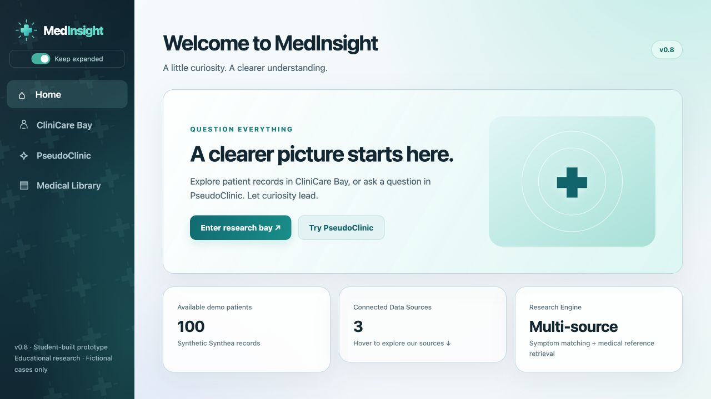
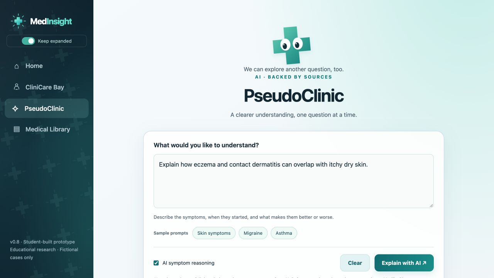
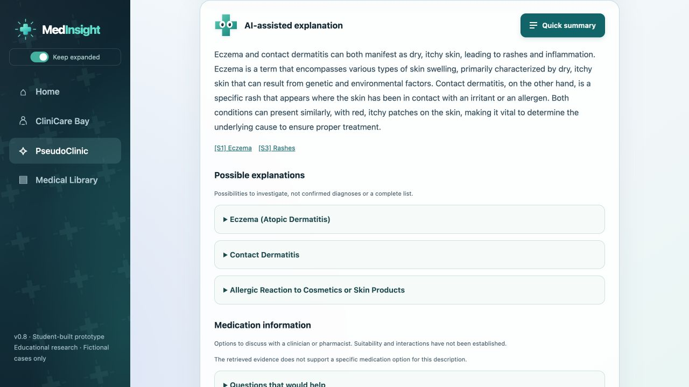
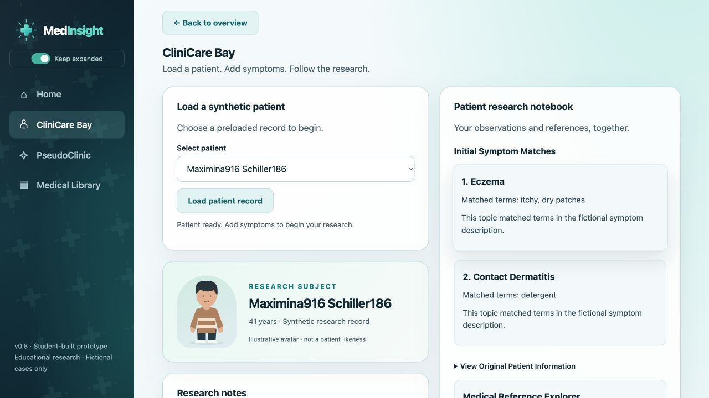
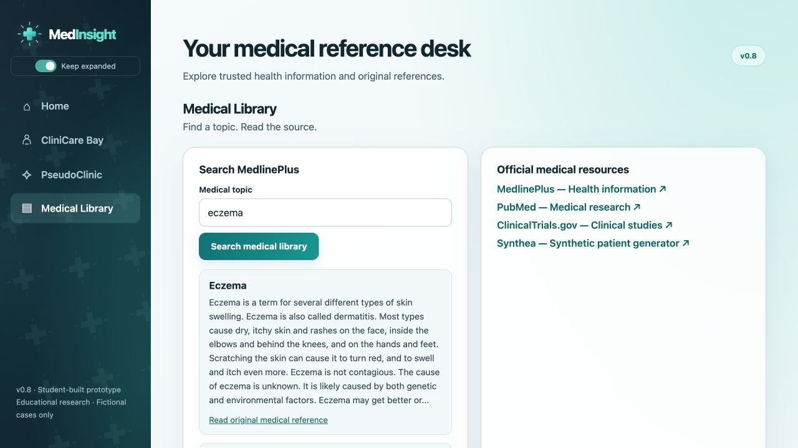

# MedInsight AI

**Question everything. Explore the sources.**

MedInsight is a student-built medical research workspace with fictional patient records, a searchable reference library, and **PseudoClinic**, an optional AI Analyzer that turns a symptom description into source-linked educational explanations.

[Live app](https://medinsight-ai-e7ps.onrender.com) · [GitHub](https://github.com/jaivenk/medinsight-ai) · [Report an issue](https://github.com/jaivenk/medinsight-ai/issues)

[](https://github.com/jaivenk/medinsight-ai/actions/workflows/python-tests.yml)

> **Educational use only.** This is not a clinically validated diagnostic or prescribing tool. Possible explanations are research suggestions, not confirmed diagnoses. Use fictional, non-identifying information; do not enter real patient data or rely on the app for care decisions.

## A look inside · v0.8

These screenshots show the current local application using a bundled synthetic patient and an educational sample question. AI responses vary. They do not establish what version is running on Render.

### Home

A calm starting point, with direct paths into patient research and PseudoClinic.



### PseudoClinic

Ask a question in natural language, choose a sample, or explore references without AI. Pip responds to typing, cursor movement, and request progress.



### Source-linked explanations

Answers appear below the question, with a Quick summary toggle, possible explanations, follow-up questions, and expandable sources. Medication information appears only when supported by retrieved evidence.



### CliniCare Bay

Load a prebuilt fictional patient, then edit symptoms and research notes. Identity stays tied to the selected record; the original CSV data is unchanged.



### Medical Library

Search MedlinePlus and read original references, with links to PubMed, ClinicalTrials.gov, and Synthea.



## What you can do

| Workspace | Purpose |
|---|---|
| **Home** | Explore the app and its connected data sources. |
| **CliniCare Bay** | Load one of 100 bundled synthetic patients, add research symptoms, generate a report, and compare educational topic matches. |
| **PseudoClinic · AI Analyzer** | Interpret a full symptom description, retrieve medical references, and explore cited explanations with optional AI. |
| **Medical Library** | Search health topics and open original medical references. |

The interface includes patient illustrations, an animated cross mascot with cursor-following eyes, reduced-motion support, and an accessible sidebar switch. On desktop, the sidebar starts expanded for five seconds, then applies the session preference. Text layout stays stable as it collapses.

## How PseudoClinic works

1. **Choose a mode.** Reference-only mode needs no API key. AI reasoning is an explicit per-question opt-in and requires server configuration.
2. **Find references.** In AI mode, OpenAI interprets the complete description, including timing, context, and negation, and plans up to four public medical topic searches. There is no fixed condition keyword list in PseudoClinic. Reference-only mode searches the question directly, using up to 160 characters.
3. **Retrieve evidence.** The backend retrieves up to eight deduplicated MedlinePlus excerpts in parallel. Its reference cache lasts up to 12 hours.
4. **Build an explanation.** A second OpenAI call uses the supplied evidence to produce a concise overview, up to four possible explanations, up to three medication names/classes, and follow-up questions. Insufficient evidence can produce fewer or no suggestions.
5. **Check citations.** The model selects constrained evidence-passage IDs. The server attaches the exact passage and source, rejects unknown citations, and omits medication names absent from the cited excerpts. These checks do not prove medical accuracy or personal suitability.

Quick summary shows the first sentence of each overview section, retaining citations; it does not make another AI request. Full explanation restores the text. Fast responses have a minimum 1.4-second thinking animation; requests begin immediately, and care notices bypass that visual delay.

Potential immediate-danger descriptions can produce a care notice before reference retrieval. This is **not validated triage** and cannot rule out an emergency. Missing keys, unavailable references, and invalid model output produce explanatory notices or reference-only fallbacks.

CliniCare Bay keeps its separate educational keyword/profile matching engine. Its topic matches and reference order are not diagnostic probabilities.

## Stack and sources

| Layer | Technology |
|---|---|
| Backend | Python, FastAPI, Pydantic, Uvicorn |
| Frontend | HTML, CSS, vanilla JavaScript; locally drawn SVG illustrations |
| Optional AI | OpenAI Chat Completions with structured JSON output |
| Health references | [MedlinePlus](https://medlineplus.gov/) from the U.S. National Library of Medicine |
| Terminology lookup | [NLM Clinical Tables](https://clinicaltables.nlm.nih.gov/) |
| Fictional patients | [Synthea](https://synthetichealth.github.io/synthea/) CSV records |
| Hosting and checks | Render, GitHub, GitHub Actions |

PubMed and ClinicalTrials.gov are outbound reading links in the Library; PseudoClinic's retrieved evidence comes from MedlinePlus.

## Run locally

Requires Python 3.10+ and internet access for reference retrieval. From this repository:

```bash
cd backend
python3 -m venv .venv
source .venv/bin/activate
pip install -r requirements.txt
uvicorn main:app --reload
```

On Windows, activate with `.venv\Scripts\activate` instead.

Open **http://127.0.0.1:8000** and keep the server running. Do not use the HTML file as a standalone app: its API routes require FastAPI. Direct file opens redirect to the local server on port 8000.

The four bundled sample CSVs are tracked in `backend/data/`. Other CSV files are ignored by default. Replacement patient datasets must remain fictional.

### Optional AI configuration

Set `OPENAI_API_KEY` in the **server environment**. `OPENAI_MODEL` defaults to `gpt-4o-mini` and must support structured output. `backend/.env.example` lists the variable names with no key; the app does not automatically load `.env` files.

For local zsh, enter a key without displaying it or putting its value in shell history, then start the server from the same terminal:

```zsh
read -s 'OPENAI_API_KEY?OpenAI API key: '
export OPENAI_API_KEY
export OPENAI_MODEL=gpt-4o-mini
uvicorn main:app --reload
```

API billing and model access must be available in the associated OpenAI project. A ChatGPT subscription does not configure this app's server.

**Never place a key in frontend code, screenshots, Git commits, or browser requests.** `.env` files are ignored except for the empty example. `/ai-analyzer/status` returns availability only, never credentials. Provider failures are converted into generic messages.

### Data flow and privacy

- AI mode sends the full question and retrieved excerpts to OpenAI. Requests use `store: false`; provider retention policies still apply.
- The AI planner is instructed to strip personal details from the short search topics sent to MedlinePlus. This is not a guaranteed anonymization mechanism.
- Reference-only mode sends the question directly to MedlinePlus. Library and patient research features also send their search terms to NLM services.
- The app does not intentionally save Analyzer questions or answers. Hosting infrastructure and development tools may retain data. Use fictional information only.

## Tests and verification

From the project root:

```bash
backend/.venv/bin/python -m pip install pytest httpx
backend/.venv/bin/python -m pytest -q
```

The current suite contains **46 tests**. GitHub Actions runs it on Python 3.12. Tests cover the existing patient/report/favicon routes plus Analyzer input validation, full-description planning, opt-in, missing configuration, urgent-notice short-circuiting, citation/evidence checks, unsupported medication names, unsafe links, incomplete/refused output, outages, and secret-safe errors.

Upstream services are mocked in automated tests. Passing tests do not establish diagnostic accuracy or a working production API key. Local browser checks additionally verified a live AI answer with citations, Quick summary, synthetic patient loading/report generation, all four navigation tabs, and MedlinePlus search. README screenshots were captured from those local flows.

Before accepting a deployment, verify the same flows on the Render URL and confirm AI availability separately from reference-only retrieval.

## Deploy the existing Render service

This repository backs [the existing Render app](https://medinsight-ai-e7ps.onrender.com). Update that service rather than creating a second project.

| Setting | Value |
|---|---|
| Repository | `jaivenk/medinsight-ai` |
| Branch | `main` |
| Root directory | `backend` |
| Build command | `pip install -r requirements.txt` |
| Start command | `uvicorn main:app --host 0.0.0.0 --port $PORT` |
| Optional private variables | `OPENAI_API_KEY`, `OPENAI_MODEL` |

Run the tests, commit the intended files, and push `main`. Auto-deploy was disabled when the existing service was inspected for this release; choose **Manual Deploy → Deploy latest commit** after the push. If automatic deployment is enabled later, watch its deployment in the existing Render dashboard. Check the deployed commit, build logs, homepage, favicon, patient list, Library search, and `/ai-analyzer/status`; then test an educational AI sample when the production key is configured.

Local environment variables do not transfer to Render. A key must be entered privately in Render's Environment settings to enable hosted AI. Keep reference-only mode available when no production key is configured. Roll back to the last successful deploy in Render if post-deployment checks fail.

The app currently has no authentication, rate limiting, or AI spending controls. An unrestricted public deployment with a configured key can consume paid API usage; those controls remain future work.

## API reference

| Method | Route | Purpose |
|---|---|---|
| GET | `/` | Interface |
| GET | `/favicon.svg` | Custom favicon |
| GET | `/ai-analyzer/status` | Server-side AI availability boolean |
| POST | `/ai-analyzer` | `{ "prompt": "Explain eczema", "use_ai": false }` |
| GET | `/patients` | Bundled synthetic patient list |
| GET | `/patients/{patient_id}` | Synthetic record and related history |
| POST | `/analyze` | Fictional-case report |
| POST | `/differential-case` | Educational symptom-profile matches |
| POST | `/research-case` | Medical reference retrieval |
| GET | `/medical-topics?search=eczema` | Library search |

Analyzer responses include `mode` (`ai_assisted`, `reference_only`, or `safety_notice`), searched terms, cited sections, possibilities, medication information, follow-up questions, sources, warnings, a safety notice, and a UTC retrieval timestamp. The timestamp marks the request, not source publication; excerpts may be cached.

## Project layout

```text
backend/
  main.py                 FastAPI application and patient/report routes
  analyzer_engine.py      Optional AI planning, retrieval, and evidence checks
  differential_engine.py  Educational symptom profiles
  research_engine.py      Reference and terminology services
  index.html              Interface, navigation, and animations
  favicon.svg             Custom favicon
  requirements.txt
  .env.example            Variable names only
  data/                   Bundled synthetic patient CSVs
  tests/                  Backend regression tests
docs/images/              Application screenshots
.github/workflows/        Backend CI
pytest.ini                Root-level test configuration
```

## Limits and next steps

MedInsight has no clinical validation, diagnostic accuracy benchmark, physical examination, complete differential, prescription service, or complete medication/interaction assessment. AI can misinterpret symptoms and warning signs or produce unsupported claims despite citation checks. Retrieved references are incomplete and depend on external service availability.

Planned work includes automated browser regression tests, stronger retrieval/ranking, usage controls, and clinically informed evaluation of educational explanations. Patient research and PseudoClinic remain learning tools rather than healthcare services.

## About

Built by Jai Venkamsetty as an independent project exploring medicine, biology, and software. Contributions and reproducible bug reports are welcome through GitHub issues.

See [LICENSE](LICENSE) for the repository's license terms.
