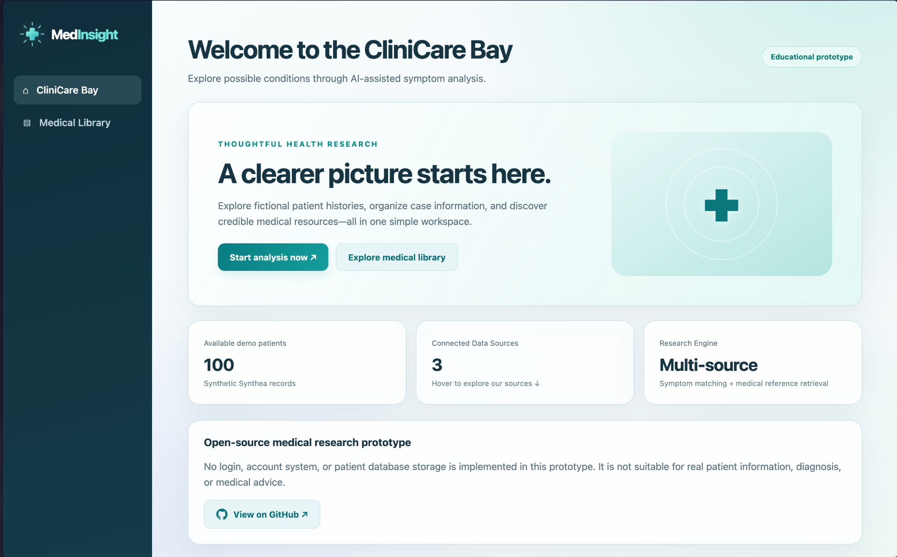
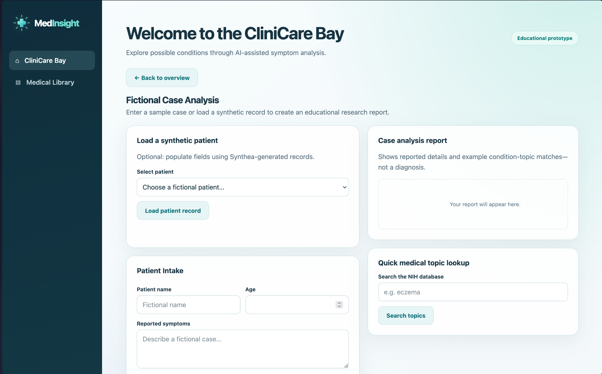
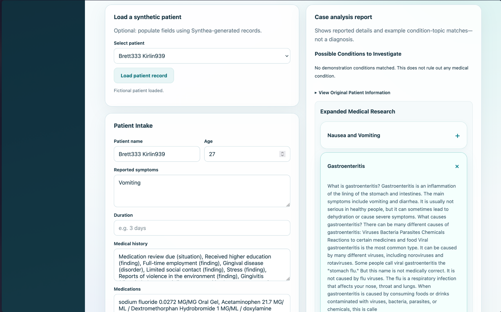
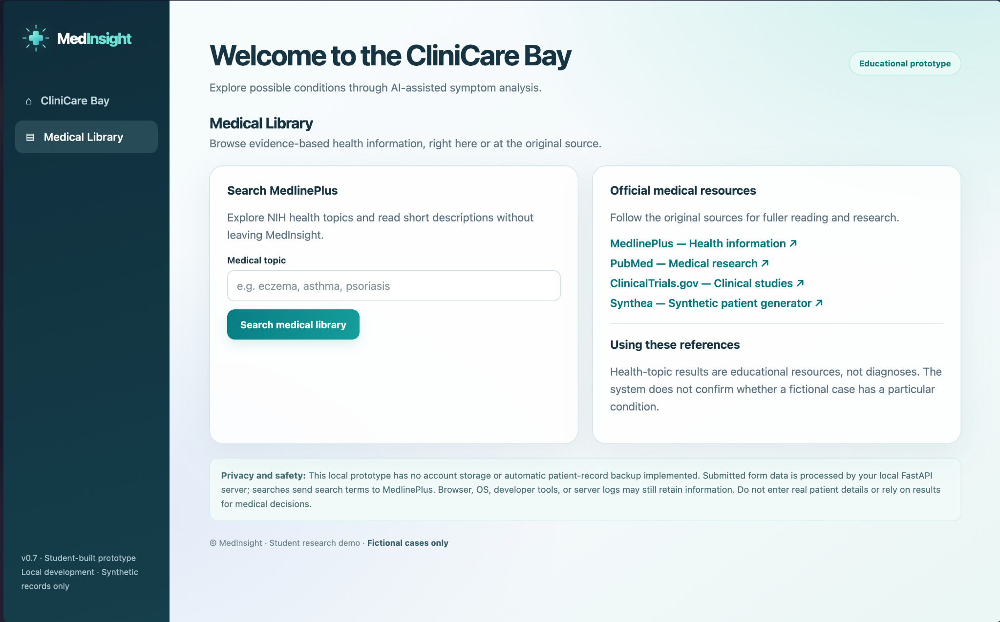

# MedInsight AI

**An Educational Medical Research & Case Exploration Platform**

[](https://medinsight-ai-e7ps.onrender.com)
[](https://www.python.org/)
[](https://fastapi.tiangolo.com/)

[](https://github.com/jaivenk/medinsight-ai/actions/workflows/python-tests.yml)

**[Live Website](https://medinsight-ai-e7ps.onrender.com) · [Source Code](https://github.com/jaivenk/medinsight-ai)**

---

## Overview

MedInsight AI is an independent student-developed web application exploring the intersection of medicine, biology, and software engineering.

The platform provides an interactive environment for exploring fictional patient cases, organizing symptom information, and retrieving educational medical references from established information sources.

Rather than attempting to diagnose patients, MedInsight AI focuses on making medical information easier to explore and understand through structured case reports, research-topic matching, and accessible presentation.

The application is built using **Python, FastAPI, HTML, CSS, and JavaScript**, and is deployed as a publicly accessible web service.

> **Important:** MedInsight AI is an educational research prototype, not a diagnostic tool or a clinically validated AI system. It does not provide diagnoses, disease probabilities, treatment recommendations, or medical advice. Do not enter real patient information.


## Application Preview

### CliniCare Bay — Dashboard

A centralized workspace for exploring fictional cases, synthetic
patient records, and trusted medical references.



### Features in Action

<table>
  <tr>
    <td width="50%">
      <strong>Fictional Patient Intake</strong>
      
    </td>
    <td width="50%">
      <strong>Medical Research Results</strong>
      
    </td>
  </tr>
</table>

### Medical Library

Explore health information and access established medical
reference sources.




## Features

### Fictional Patient Case Analysis

- Structured intake for fictional patient names, ages, symptoms, symptom duration, medical history, medications, and allergies.
- Educational keyword-based condition matching.
- Generated reports summarizing fictional case information.
- Research-topic suggestions based on provided descriptions.

### Multi-Source Medical Research

- MedlinePlus integration for health information from the U.S. National Library of Medicine.
- NLM Clinical Tables integration for medical terminology lookup.
- Research-result organization with expandable condition cards.
- On-demand searches of external reference services.

### Synthetic Patient Records

- Optional integration with Synthea-generated fictional patient data.
- Patient selection and demographic information retrieval.
- Access to synthetic conditions, medication records, and allergies.
- Support for structured exploration of simulated medical histories.

*Note: Synthea CSV datasets are stored locally and are not included in the public repository. This feature requires additional data configuration in deployed environments.*

### Medical Library

- Search health topics using MedlinePlus.
- Review short research summaries.
- Open original references for additional reading.
- Access PubMed, ClinicalTrials.gov, and other educational resources.

### Interactive Dashboard

- Responsive interface with teal-and-navy branding.
- Dedicated case-analysis workspace.
- Expandable research results.
- Interactive source information and navigation.
- No account creation required.

---

## Technology Stack

| Layer | Technology |
|---|---|
| Backend | Python, FastAPI |
| ASGI Server | Uvicorn |
| Frontend | HTML5, CSS3, JavaScript |
| Health Information | NIH MedlinePlus |
| Terminology Search | NLM Clinical Tables |
| Synthetic Data | Synthea |
| Version Control | Git, GitHub |
| Deployment | Render |

## System Architecture

```text
                  USER
                    |
                    v
          MedInsight Web Interface
            HTML / CSS / JS
                    |
                    v
             FastAPI Backend
                    |
          +---------+---------+
          |         |         |
          v         v         v
       Case      Research   Synthetic
      Analysis    Engine    Patient Data
          |         |         |
          v         v         v
       Keyword   MedlinePlus  Synthea
       Matching  NLM Tables   CSV Files
          |         |         |
          +---------+---------+
                    |
                    v
          Educational Results
```

The backend exposes endpoints for fictional case analysis, medical reference retrieval, health-topic lookup, and synthetic patient records.

## Project Structure

```text
medinsight-ai/
├── backend/
│   ├── main.py
│   ├── research_engine.py
│   ├── index.html
│   ├── favicon.svg
│   ├── requirements.txt
│   └── data/                 # Local synthetic datasets
├── .gitignore
└── README.md
```

## Getting Started

### Requirements

- Python 3.10+
- pip
- Internet access for external medical references

### 1. Clone the repository

```bash
git clone https://github.com/jaivenk/medinsight-ai.git
cd medinsight-ai/backend
```

### 2. Create and activate a virtual environment

```bash
python3 -m venv .venv
source .venv/bin/activate
```

On Windows, activate with:

```powershell
.venv\Scripts\activate
```

### 3. Install dependencies

```bash
pip install -r requirements.txt
```

### 4. Start the server

```bash
uvicorn main:app --reload
```

Visit **http://127.0.0.1:8000**.

Alternatively, use the **[Live Demo](https://medinsight-ai-e7ps.onrender.com)** without installing anything.

### Optional: Synthetic Patient Data

Generate synthetic patient data using [Synthea](https://github.com/synthetichealth/synthea), then place the required CSV files inside `backend/data/`.

The patient-loading functionality expects files including `patients.csv`, `conditions.csv`, `medications.csv`, and `allergies.csv`.

These datasets are excluded from version control. The public deployment may not have this feature configured.

---

## How the Research Engine Works

**1. Case intake:** A user enters details for a fictional patient or selects a synthetic record.

**2. Topic matching:** The application identifies example condition topics using predefined symptom keywords and terminology matching.

**3. Reference retrieval:** The backend requests information from MedlinePlus and NLM Clinical Tables.

**4. Results presentation:** Relevant reference matches are organized into readable reports and expandable research cards.

**5. Further exploration:** Users can search additional topics and visit original medical references.

Research matches are informational associations rather than clinically validated predictions. The system does not calculate diagnostic probabilities or establish that a patient has any particular medical condition.

## Deployment

MedInsight AI is deployed using **Render**, with source code maintained on GitHub.

The hosted application runs FastAPI as a cloud web service, allowing users to access the interface without installing Python or operating a local server.

**Live application:** https://medinsight-ai-e7ps.onrender.com

The service uses Render's free hosting tier, so initial requests may be delayed after periods of inactivity.

## Current Limitations

- No trained medical diagnostic machine-learning model.
- No clinical validation or diagnostic accuracy benchmarking.
- No user authentication or persistent patient database.
- External research searches depend on third-party service availability.
- Public deployment does not currently include the local synthetic patient datasets.
- Not intended for healthcare decision-making or use with identifiable patient data.

## Development Roadmap

- [ ] Expand medical terminology matching and result ranking
- [ ] Improve reference transparency and research citations
- [ ] Add automated backend and frontend tests
- [ ] Configure synthetic patient datasets for cloud deployment
- [ ] Improve mobile accessibility and responsiveness
- [ ] Introduce more advanced research filtering
- [ ] Add example cases and interface screenshots
- [ ] Explore clinically informed evaluation methods for educational research matching

---

## Motivation

MedInsight AI began as an independent project motivated by an interest in medicine, biology, and the potential for software based medical care within a new age. 

The project serves as a practical exploration of API integration, backend development, frontend interaction, research retrieval, and deployment.

It is an evolving educational platform intended to support learning and experimentation.

## Developer

**Jai S. Venkamsetty**

GitHub: [@jaivenk](https://github.com/jaivenk)

---

*MedInsight AI is an independent educational project. It is not affiliated with or endorsed by the National Institutes of Health, the National Library of Medicine, or Synthea.*

**Built for research, exploration, and learning.**
